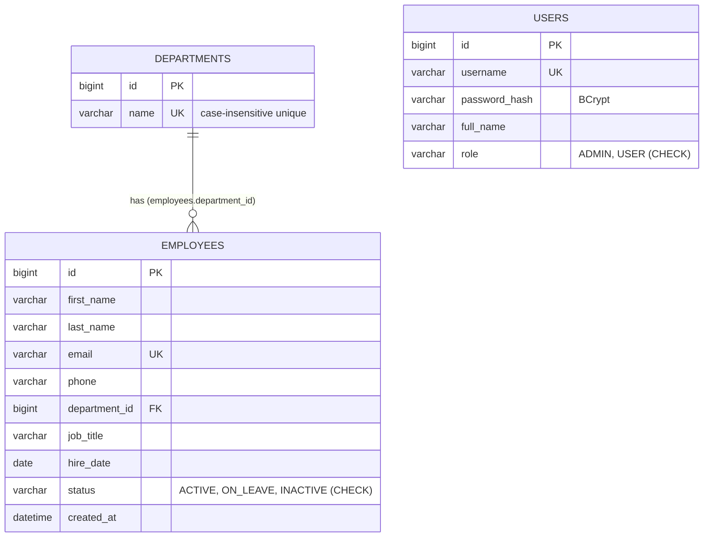

# Roster - Employee Management (Angular 19 + Spring Boot 3 + MySQL)

Small full-stack app for the Application Developer skill assessment.
**Included:** login / logout (JWT), one transaction module (Employee CRUD), one report module
(filters, summary cards, paginated table, Excel and PDF export).

## Stack
| Layer | Tech |
|---|---|
| Frontend | Angular 19 (standalone components, signals), Reactive Forms, Angular Material |
| Backend | Spring Boot 3.3, Spring Security (JWT), Spring Data JPA / Hibernate |
| Database | MySQL 8, schema managed by Flyway migrations |
| Exports | Apache POI 5.3 (Excel), OpenPDF 2.0 (PDF) |
| Tests | JUnit 5, Mockito, Spring MockMvc (40 tests) |

## Prerequisites
Java 17+, Maven 3.9+, Node 20+ (npm), MySQL 8 (or Docker). The first backend start downloads the Maven dependencies, so it needs internet.

## Run it
```bash
# 1. Database (skip if you already run MySQL with root/root)
docker compose up -d

# 2. Backend  ->  http://localhost:8080
cd backend
mvn spring-boot:run            # tests: mvn test

# 3. Frontend  ->  http://localhost:4200
cd frontend
npm install
npm start
```
Different MySQL credentials? `DB_USER=... DB_PASSWORD=... mvn spring-boot:run`.
Always set a real `JWT_SECRET` (32+ chars) outside local development.

## Build and run from scratch (Windows PowerShell or any shell)
1. **Check the tools** (each should print a version): `java -version` (17+), `mvn -v` (3.9+), `node -v` (20+), `npm -v`, and MySQL 8 running on port 3306.
2. **Backend:** `cd backend`, then `mvn test` (40 tests), then `mvn spring-boot:run`. The first run downloads dependencies and creates the `roster_db` database and the demo data. Wait for `Started RosterApplication`.
3. **Frontend:** open a second terminal, `cd frontend`, `npm install`, `npm start`. Open http://localhost:4200.
4. **First-run checks:** log in as `admin` / `Admin@123`; the Employees page shows 13 people; open **Report** and click **All time** to see the cards and the table; try both export buttons.
5. **Production-style build (optional):** `cd backend && mvn -DskipTests package` makes `target/roster-api-1.0.0.jar` (run it with `java -jar`); `cd frontend && npm run build` makes `dist/roster-web` (this step needs internet to inline the Google font).

Common problems are listed in `BUILD_GUIDE.md`.

## Database
Schema: `backend/src/main/resources/db/migration/V1__create_schema.sql` (Flyway runs it once on an empty database;
Hibernate does not change the schema: `ddl-auto=none`).


- **Relationship:** one department has many employees (`fk_employee_department`). A department cannot be deleted while employees use it.
- **Constraints:** primary keys; unique username, employee email and department name; NOT NULL on every business column; CHECK on `status` and `role`.
- **Indexes:** `(hire_date, status)` serves the report filter and hires-per-month query; `last_name` serves the default list sort; the foreign key is indexed automatically.
- **The API still sends a department name.** The service finds the department (case-insensitive) or creates it, so the screens did not change.
- **Upgrading from an earlier version of this project:** the old database was created by Hibernate and Flyway will refuse to touch it. Run `DROP DATABASE roster_db;` in MySQL once, then start the backend.

## Demo accounts (seeded on first start)
| Username | Password | Role | Can do |
|---|---|---|---|
| admin | Admin@123 | ADMIN | view, add, edit, delete, reports |
| viewer | Viewer@123 | USER | view and reports only (action buttons hidden, write API calls return 403) |

## API
All endpoints except login need `Authorization: Bearer <token>`.

| Method | Path | Role | Notes |
|---|---|---|---|
| POST | /api/auth/login | public | `{username,password}` -> `{token,username,fullName,role,expiresInSeconds}` |
| GET | /api/employees | any | query: `q`, `page` (0-based), `size` (max 50), `sort`, `dir` (asc/desc) |
| GET | /api/employees/{id} | any | 404 if unknown |
| POST | /api/employees | ADMIN | 201; 400 validation; 409 duplicate email |
| PUT | /api/employees/{id} | ADMIN | 404 unknown id; 409 duplicate email |
| DELETE | /api/employees/{id} | ADMIN | 204 |
| GET | /api/reports/employees | any | report table by hire date. query: `from`, `to` (yyyy-MM-dd, default current month), `status`, `page`, `size` (max 50), `sort`, `dir` (default hireDate desc). 400 if `from` > `to` |
| GET | /api/reports/employees/summary | any | same filters; returns `{from,to,total,byStatus,byDepartment,byMonth}` (hires per month, latest 24 months) |
| GET | /api/reports/employees/export.xlsx | any | same filters; every matching row (max 10,000) as an Excel file |
| GET | /api/reports/employees/export.pdf | any | same filters; formatted PDF with title, filters, date and page footer |

Sortable fields: firstName, lastName, email, department, jobTitle, hireDate, status (anything else falls back to the default).
Error shape: `{ "message": "...", "errors": { "field": "message" } }`.

## Use-case coverage
| ID | Status | Where |
|---|---|---|
| UC-LOGIN-01/02 | Done | `features/login`, `AuthController`, `JwtService` |
| UC-LOGIN-03 | Partial | username remembered; token refresh not built |
| UC-LOGIN-04 | Done | `core/idle.service.ts` (warning at 28 min, logout at 30) |
| UC-TXN-01..06 | Done | `features/employees`, `EmployeeService`; search debounced 300 ms |
| UC-RPT-01 | Done | `features/report` table, `ReportService.list` (server-side paging and sorting, date and status filters) |
| UC-RPT-02 | Done | `ExcelReportBuilder`, `GET /api/reports/employees/export.xlsx` |
| UC-RPT-03 | Done | `PdfReportBuilder`, `GET /api/reports/employees/export.pdf` (title, date, table, page footer) |
| UC-RPT-04 | Done | summary cards: total, per status, per department, and hires per month (SQL COUNT + GROUP BY, `year()`/`month()`) |
| UC-RPT-05 | Done | date-range picker, default current month, presets, server rejects from > to |
| UC-LOGOUT-01/02 | Done | `AuthService.logout`, `authGuard`, interceptor 401 handling |

## Tests
`cd backend && mvn test` runs 40 tests: employee and report service rules, JWT, the Excel and PDF builders,
and MockMvc tests of the real security chain (400, 401, 403, 404, 409).

## Security notes
BCrypt password hashes; stateless JWT (HS256, 30 min); route guard + HTTP interceptor;
`@PreAuthorize` role checks; Bean Validation on every request body; parameterised JPQL and a sort-field whitelist
(no string-built SQL); export size capped; CORS limited to http://localhost:4200.
Known trade-off: the JWT is kept in localStorage as the assessment specifies, which is readable by any XSS.

## Known limitations
- The PDF uses a built-in Latin font, so non-Latin names (for example Devanagari) would not render; embed a Unicode font to fix.
- Exports stop at 10,000 rows and say so in the file.
- Departments are created from the name typed in the employee form (no separate department screen). Two requests creating the same new department at the same moment could hit the unique constraint.
- `ddl-auto=none` means a mismatch between the entities and the SQL would only show up when a query runs; a production setup would add schema validation or integration tests against MySQL.
- Search uses a leading-wildcard `LIKE`, which cannot use an index on very large tables.
- No refresh token; users are signed out after 30 minutes.
